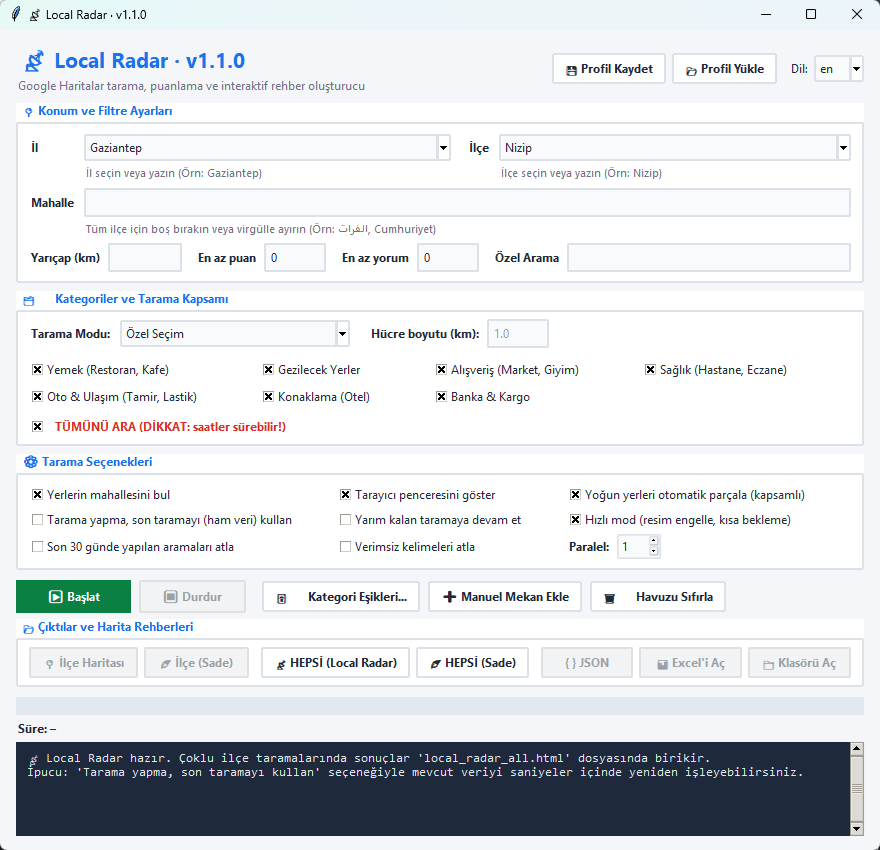

# 📡 Local Radar

**Scan, discover, plan.** — Find the best local places around you.

Local Radar is a personal travel-guide generator. It scrapes Google Maps for highly rated places in a given district or neighborhood, filters them by rating and review count, categorizes them automatically, and generates a modern interactive HTML guide.

**Available in Turkish and English** — switch language from the top-right dropdown.

## 🌐 Live Guides

Guides for hundreds of Turkish districts, built with this tool, are published here:

👉 **[https://cisey.github.io/LocalRadar/](https://cisey.github.io/LocalRadar/)** (repo: [cisey/LocalRadar](https://github.com/cisey/LocalRadar))

- 🗺️ Pick a province or district from an interactive Turkey map
- 📍 "Find my location" lists the best places near you, sortable by food type
- 📚 Every province has a merged "All Districts" guide

## ✨ Features

- 🗺️ **Interactive map** — Leaflet + OpenStreetMap, no API key needed
- 🎨 **Modern dark theme** — Clean cards, gradient accents, mobile-first design
- 📱 **Mobile-friendly** — Responsive design with tap-friendly rows
- 🌙 **Dark mode** — Automatic, based on system preference
- 🌍 **Multi-language UI** — Turkish and English
- 🩹 **Self-healing scraper** — Resilient CSS selectors with multi-fallback
- 🧩 **Smart grid** — Auto-splits dense areas to get around Google's ~120 result limit
- 🔎 **Live filters** — Search, neighborhood dropdowns, sort, min rating/review
- 🏷️ **Category tabs** — One-tap filtering by section
- 📌 **Google Maps button** — One click to open any place in Google Maps
- 💾 **Multiple export formats** — HTML, CSV, XLSX, JSON, KML
- 🔀 **Pool merging** — Multi-district scans accumulate into a single master guide
- ▶️ **Resume support** — Interrupted scans can be continued
- ➕ **Manual add** — Insert places Google missed
- 🌙 **Night Scan** — Queue dozens of districts and let them run unattended (see below)
- ⚡ **Skip scanned areas** — Cells already scanned in the last 60 days are not opened again

## 🧠 What It Does

1. **Location lookup** — Nominatim (OpenStreetMap) resolves the district to coordinates
2. **Grid generation** — Slippy-map tiles divide the area into searchable cells
3. **Search** — Playwright navigates to each Google Maps search URL and scrolls the feed
4. **Extraction** — Parses name, rating, review count, address, and coordinates
5. **Filtering** — Removes permanently closed, out-of-area, low-review places
6. **Categorization** — Rule-based classifier with 200+ Turkish keywords
7. **Neighborhood detection** — OpenStreetMap boundaries + address parsing + Nominatim fallback
8. **Deduplication** — Same name + coordinates merged automatically
9. **Export** — CSV, XLSX, JSON, KML, and interactive HTML

## 🌙 Night Scan (batch mode)

Night Scan scans a whole list of districts one after another, overnight, with no one at the keyboard.

**1. Write your list** in `gece_ilceler.txt`, one district per line:

```
Hatay/Antakya
Gaziantep/Nizip:15
Izmir/Konak
```

`Province/District` is required. An optional `:km` sets the scan radius.

**2. Run it** and choose **1**:

```bash
python gece_tarama.py
```

**What it does for each district**

- Scans the area, builds the HTML guide, and uploads it to your GitHub Pages repo
- Rebuilds the province's merged **"All Districts"** guide (the same place appears once)
- Resumes an interrupted district where it stopped
- Skips search cells scanned in the last 60 days (`TEKRAR_ONLEME_GUN`)
- If Google blocks the session, waits and retries instead of crashing
- Optionally sends a Telegram message when done
- Adds the Google Analytics tag to every guide it uploads

**Menu**

| Key | Action |
|-----|--------|
| 1 | Start the night scan |
| 2 | GitHub login test (first setup only) |
| 3 | Telegram test message |
| 4 | Find your Telegram chat id automatically |
| 5 | Build every province's merged guide now and upload it |
| 6 | Add the Analytics code to all existing guides and upload |

**Tips**

- Keep `PARALEL_SAYISI = 1` unless your PC has plenty of RAM; two windows can crash weaker machines.
- Keep tokens (`telegram_ayar.json`, GitHub token) **out of the repo**. They are listed in `.gitignore`.

## 🌍 Languages

Local Radar supports **Turkish** and **English**.

| Language | Description |
|----------|-------------|
| 🇹🇷 Türkçe | Şehir, ilçe, mahalle, kategori gibi alanlar Türkçe etiketlerle görünür. |
| 🇬🇧 English | All labels, buttons, and messages in English. |

**Switch language:** Use the dropdown in the top-right corner. The interface updates instantly, and your choice is saved.

**Adding a new language:**

1. Open `local_radar_core.py`
2. Find the `METINLER` dictionary
3. Copy the `"en"` block
4. Translate all values to your language
5. Rename the key (e.g. `"de"` for German)
6. Add it to the language dropdown values (values=["tr", "en", "de"])

## 🚀 Quick Start

### Requirements

- Python 3.10 or newer
- Windows, Linux, or macOS
- Playwright (Chromium or Edge)
- openpyxl (for Excel output)

### Installation

Open your terminal and run:

```bash
git clone https://github.com/cisey/local-radar.git
cd local-radar
pip install -r requirements.txt
playwright install chromium
python local_radar_gui.py
```

### Quick Launch (Windows)

Double-click **`run.bat`** to launch the GUI without opening a terminal. The batch file automatically:

- Changes to the project directory
- Checks if Python is installed
- Launches `local_radar_gui.py`
- Keeps the window open if an error occurs

### First Scan

1. Open the GUI
2. Select your language from the top-right dropdown
3. Type a City (e.g. Gaziantep) — the district list will load
4. Select a District (e.g. Şahinbey)
5. Choose a scan mode:
   - **Fast** — Food + Attractions (quick)
   - **Normal** — Food + Attractions, grid-enabled (recommended)
   - **Food only** — Restaurants, cafes, bakeries, butcher
   - **Comprehensive** — Everything (may take hours)
   - **Fixed grid** — Custom cell size in km
6. Set minimum rating and review count
7. Click **Start**

Wait 5 to 20 minutes depending on the area.

## 📂 Project Structure

```
local-radar/
├── local_radar_core.py      Core engine (scraper, categorizer, exporters)
├── local_radar_gui.py       Tkinter GUI (TR/EN)
├── gece_tarama.py           Night Scan batch runner
├── gece_ilceler.txt         Night Scan district list
├── test_local_radar.py      Basic test suite
├── requirements.txt         Python dependencies
├── run.bat                  Windows quick launcher
├── README.md                This file
├── LICENSE                  MIT License
└── .gitignore               Excludes personal data from Git
```

Data files (pool, caches, output guides) are **not** committed to Git — they live outside the repo.

## 📤 Output Formats

| Format | Purpose |
|--------|---------|
| **HTML** | Interactive guide with map, filters, category tabs, sort options |
| **CSV** | Raw data for spreadsheet analysis |
| **XLSX** | Formatted Excel with color-coded ratings and clickable links |
| **JSON** | Programmatic use, easy to parse |
| **KML** | Opens in Google Earth, Google My Maps, and other GIS tools |

Each scan produces two HTML outputs:

- **District guide** — `output/YYYYMMDD_HHMM_slug/slug.html`
- **Master guide** — `local_radar_all.html` (all districts combined)

## 🗂️ File Naming

Scans are stored in the `output/` folder with timestamped directories:

```
output/
└── 20260508_1355_Karkamis/
    ├── Karkamis.html
    ├── Karkamis_places.csv
    ├── Karkamis_places.xlsx
    ├── Karkamis_places.json
    └── Karkamis_places.kml
```

The combined guide `local_radar_all.html` sits in the project root and updates automatically after each scan.

## 📸 Screenshots

### GUI (English)

The interface with English labels, language selector, and empty fields ready for input.



### Interactive Guide

The generated HTML guide with map, category tabs, and live filters.

## ⚠️ Disclaimer

This tool scrapes publicly available data from Google Maps. Use it responsibly:

- **Personal use only** — respect Google's Terms of Service
- **Rate limiting** — do not run aggressive parallel scans
- **No warranty** — Google may change its DOM at any time
- **Not affiliated with Google**

Local Radar is provided as-is for educational and personal use.

## 🤝 Contributing

Pull requests are welcome. Especially:

- More categorization keywords
- Additional language support (currently Turkish and English)
- More food sub-category rules
- Mobile app wrapper
- Docker container

## 📄 License

MIT License — see the [LICENSE](LICENSE) file for details.

## 🙏 Acknowledgments

- **Playwright** — browser automation
- **OpenStreetMap / Nominatim / Overpass** — map data
- **Leaflet** — interactive maps
- **Openpyxl** — Excel output

Made with ❤️ for travelers and foodies.
